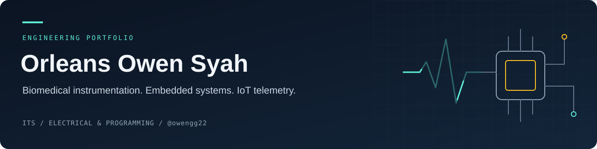

# Orleans Owen Syah

**Biomedical Instrumentation · Embedded Systems · IoT Telemetry**

Institut Teknologi Sepuluh Nopember · Class of 2024

[Explore my work](#selected-work) · [Technical stack](#technical-stack) · [Current focus](#current-focus)

---

I work with sensors, electronics, and firmware, with a focus on biomedical instrumentation and IoT telemetry.

At **ITS Team Sapuangin**, I contribute to Electrical and Programming. I also lead the technical work for **BEACON 2026** and **BMW 2026**.

### Current focus

- **Biomedical instrumentation:** sensing, signal acquisition, and hardware integration.
- **Embedded systems:** microcontroller firmware, communication interfaces, and telemetry.
- **IoT telemetry:** connecting sensors and embedded devices to monitoring systems.

### Selected work

| Project | Inside the repository | Area |
| :--- | :--- | :--- |
| [STM32 Robot](https://github.com/owengg22/robot-STM32) | STM32F103 firmware with PWM motor control and interrupt-driven UART input. | Embedded · C |
| [DSP](https://github.com/owengg22/DSP) | Study materials on system identification and P, PI, PD, and PID control. | Signals · Control |

### Technical stack

| Domain | Tools & technologies |
| :--- | :--- |
| Firmware | C · C++ · STM32 · ESP32 · Arduino · Raspberry Pi |
| Interfaces | CAN Bus · I2C · SPI · UART |
| Data & scripting | Python |
| Development | STM32CubeIDE · PlatformIO · VS Code · Git · ST-LINK |

---

**Sensors · Firmware · Connectivity · Telemetry**

[Browse repositories](https://github.com/owengg22?tab=repositories)

